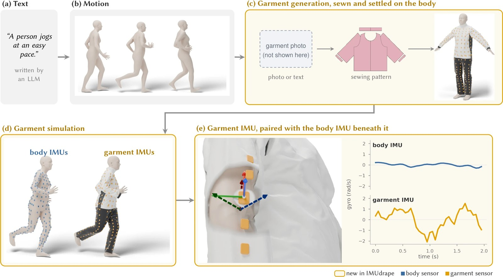
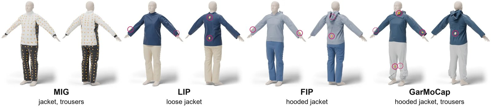

<div align="center">


### Generating Garment-Mounted Virtual IMU Data from Text through Physics-Based Cloth Simulation

**[Zikang Leng](https://zikangleng.github.io/), [Thomas Plötz](https://ploetzlab.net/)**
<br>Georgia Institute of Technology

**Under review**

[](https://zikangleng.github.io/imudrape/)
[](https://zikangleng.github.io/imudrape/)
[](https://arxiv.org/abs/2611.02393)
[](LICENSE)



<sub>From a sentence to a garment-mounted IMU. Orange panels are new in IMUdrape. The garment sensor slides and twists relative to the body, so its frame turns from 11° to 42° away from the body sensor beneath it within 1.6 s. (The dataset garment photograph used as input in panel c is not reproduced here.)</sub>

</div>

> [!NOTE]
> **Code coming soon.** The pipeline code, the matched garments and their sensor maps will be released in this repository. Watch the repo or check the [project page](https://zikangleng.github.io/imudrape/) for updates.

**Sensors sewn into clothing do not move rigidly with the body.** Loose fabric slides, twists and swings, so a garment-mounted IMU records the motion of the fabric as well as that of the person, and this extra motion differs from one garment to the next. Existing virtual IMU generators attach their sensors rigidly to the body. IMUdrape instead generates *garment-mounted* virtual IMU data from text: it synthesizes motion from activity descriptions, reconstructs the deployment's garment as a sewing pattern and dresses the body in it, places virtual IMUs at the deployment's real sensor positions, and simulates the garment with an intersection-free contact solver. Every simulation yields paired garment and body signals for the same motion.

<table align="center">
<tr>
<td align="center"><b>4</b><br>real datasets with clothing-mounted IMUs</td>
<td align="center"><b>7–46%</b><br>relative macro-F1 gain over real data alone, 1 real subject</td>
<td align="center"><b>12%</b><br>lower pose error than body-mounted virtual data (recorded motion, no real data)</td>
<td align="center"><b>+56%</b><br>macro-F1 of garment over body data with 6 sensors (MIG, no real data)</td>
</tr>
</table>

## Pipeline

1. **Text → motion.** A large language model writes varied descriptions of each activity, and a text-to-motion model (HY-Motion 1.0) turns them into SMPL body motion, as in [IMUGPT](https://github.com/ZikangLeng/IMUGPT).
2. **Garment generation.** A vision–language model (ChatGarment) reads a photograph or description of the target garment and outputs a design. A GarmentCode program turns it into sewing panels sized to the body, which are sewn shut around the body in the cloth simulator and settled under gravity with the fabric's properties.
3. **Garment simulation.** The garment is simulated on the moving body with an intersection-free contact solver. A prepared collider pushes apart intersecting limbs and fills skinning creases, so generated motion can drive the cloth.
4. **Garment IMU.** Virtual IMUs are read off small rigid patches of the simulated fabric at the deployment's real sensor positions, each paired with a body IMU beneath it.



<sub>Garments matched to the four evaluation datasets (MIG, LIP, FIP, GarMoCap), with each dataset's sensor positions.</sub>

## Key findings

- **Garment physics helps most when real data are scarce.** With one real subject, IMUdrape Body + Garment data raise recognition macro-F1 by a relative 7.2% to 46.3% over real data alone, and the best IMUdrape source stays 1.0% to 5.5% ahead with all real subjects.
- **The advantage grows with more sensors.** On MIG without real data, garment data beat body data by a relative 20.7% with one tight-fitting sensor and 56.2% with six.
- **Realistic motion adds to it.** Simulating the garment on recorded motion lowers GarMoCap pose error without real data by 29.7% to 33.3%, and garment data stay 12.1% more accurate than body data.
- **A matched garment helps most without real data.** The matched GarMoCap garment reaches 32.3% macro-F1 against 28.1% for a generic garment.

See the [project page](https://zikangleng.github.io/imudrape/) for interactive results.

## Citation

```bibtex
@misc{leng2026imudrape,
  title         = {IMUdrape: Generating Garment-Mounted Virtual IMU Data from Text
                   through Physics-Based Cloth Simulation},
  author        = {Leng, Zikang and Pl{\"o}tz, Thomas},
  year          = {2026},
  eprint        = {2611.02393},
  archivePrefix = {arXiv},
  primaryClass  = {cs.CV},
  url           = {https://arxiv.org/abs/2611.02393}
}
```
